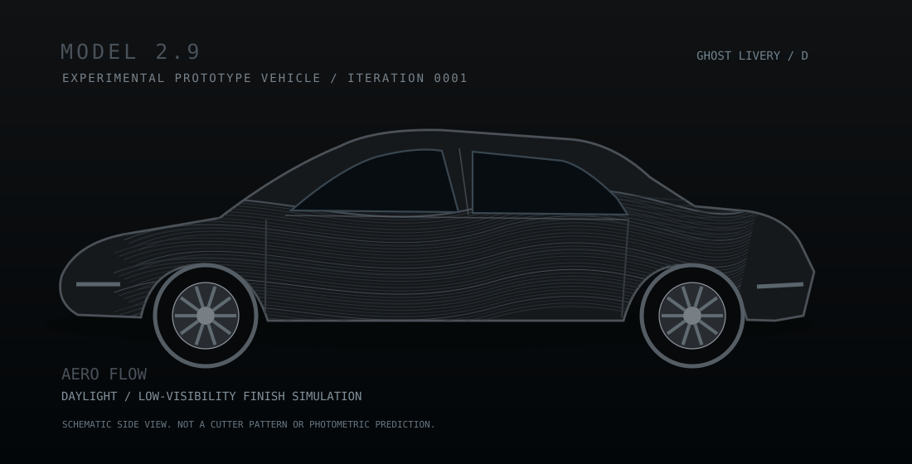
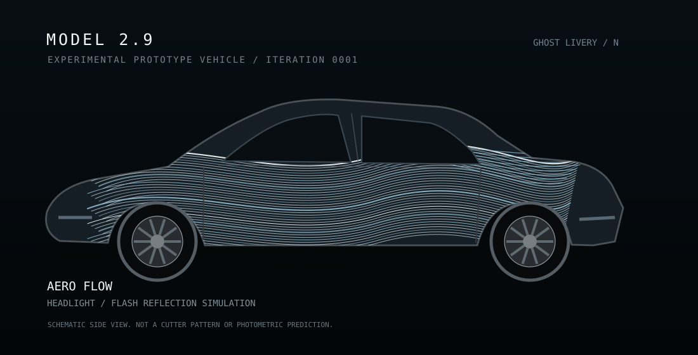
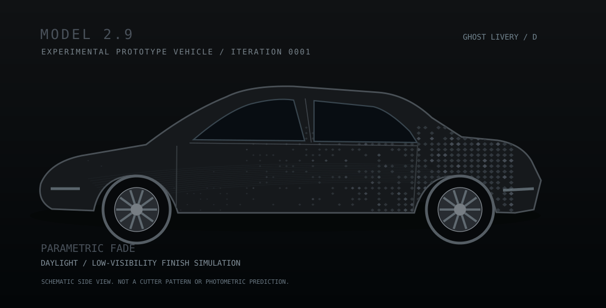
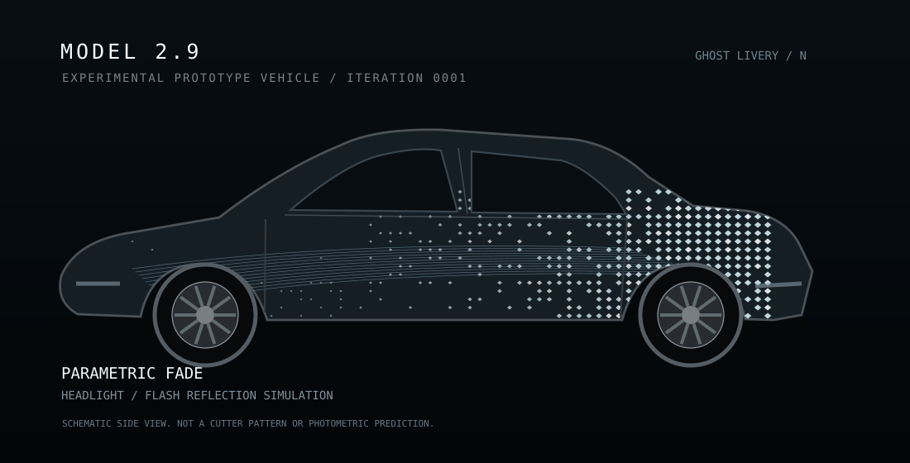
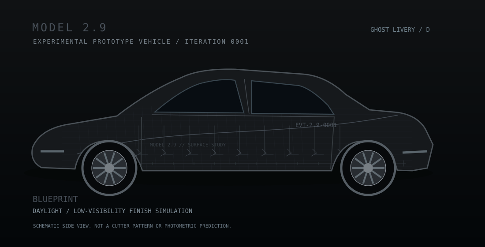
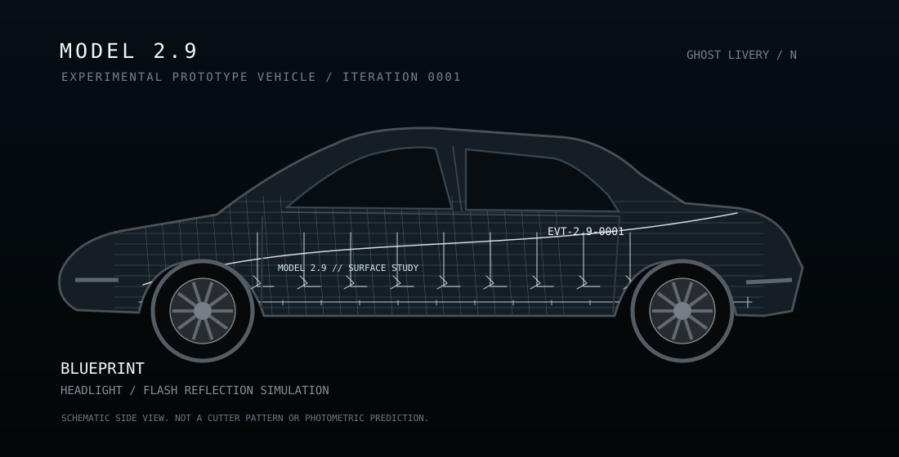

# 0001 — Ghost Reflective Texture Exploration

**Date:** 2026-10-11 · **Status:** Exploring / no owner-selected winner.

## Three directions

| Design | Daylight (concept illustration) | Night with headlight/flash (simulated) |
|---|---|---|
| **Aero Flow** — flowing contour lines |  |  |
| **Parametric Fade** — dense-to-sparse micro-diamonds |  |  |
| **Engineering Blueprint** — fine grid, technical annotations |  |  |

**Current proposal, not a decision:** blend Aero Flow + Parametric Fade; use Blueprint typography sparingly.

## Reproduce artwork

Node.js 18+ (SVG side views; no dependencies):
```sh
node livery/iterations/0001-2026-10-11-ghost-reflective/render-preview.mjs
```

Python 3.10+ and Pillow (1024×1024 Paint Shop UV PNG study, **masked using the exact original Tesla template already in this repo**):
```sh
python -m pip install Pillow
python livery/iterations/0001-2026-10-11-ghost-reflective/render-uv.py
```
This generates 6 PNGs to `renders/` (not committed in this first import). Each can be used to check 3D mapping in Paint Shop, but reflection brightness is only a concept visualization.

## Preserved earlier conversation artifacts

The initial concept session also generated separate raster UV comparisons, 2D side studies and a zip package. The versioned **SVG concept previews in this folder are new schematics of the same three directions**, not binary copies of those first PNG screenshots. The original rasters remain in the prior ChatGPT project archive; they have **not** been misrepresented as committed here.

## Constraints

- Reference: [Tesla 2024+ M3P template](../../../model3-2024-performance/template.png).
- Drawings are NOT full-scale physical vinyl cutting paths.
- Actual black film daytime tone/shine and night reflection vary with material and illumination.
- Align every UV section on the vehicle before approving placement.
