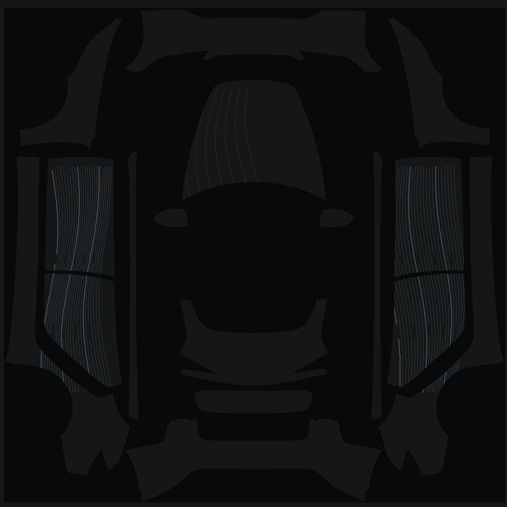
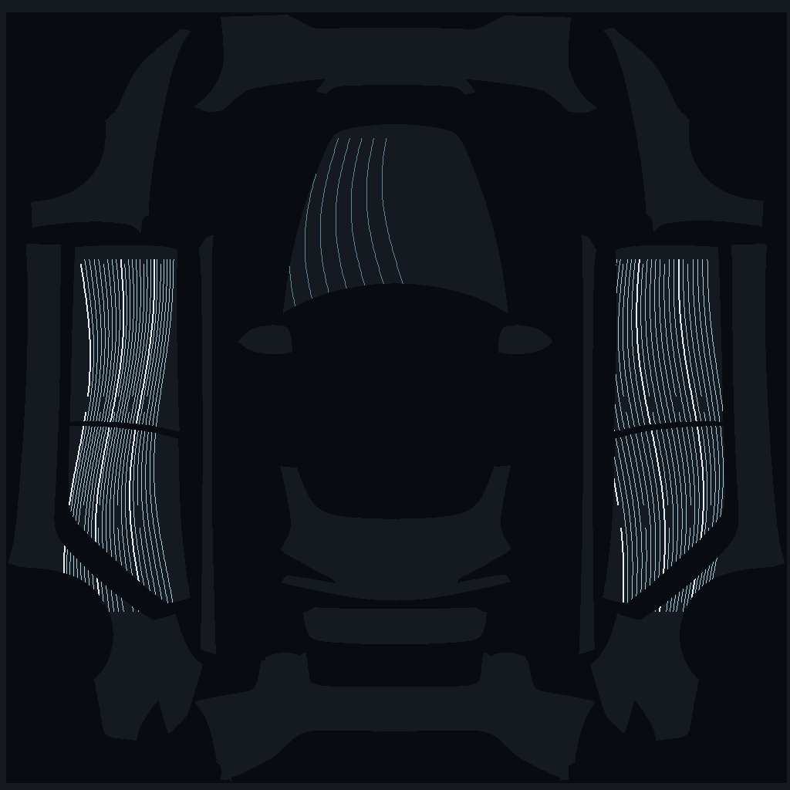
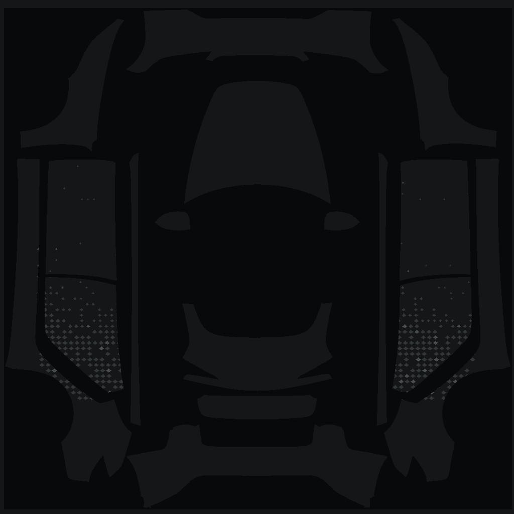
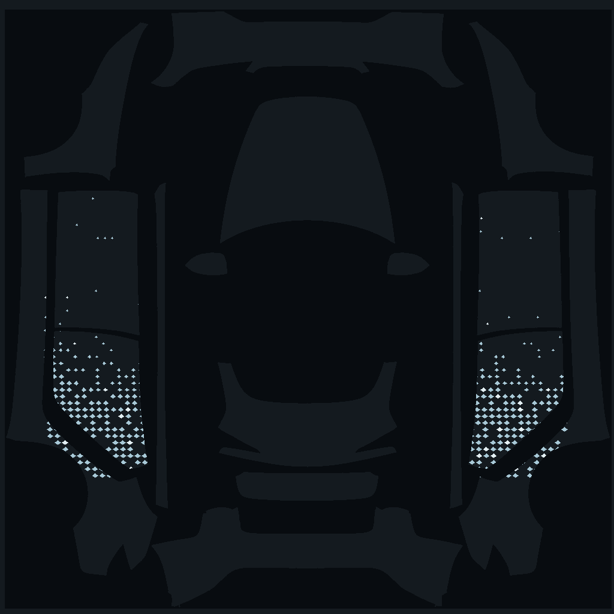
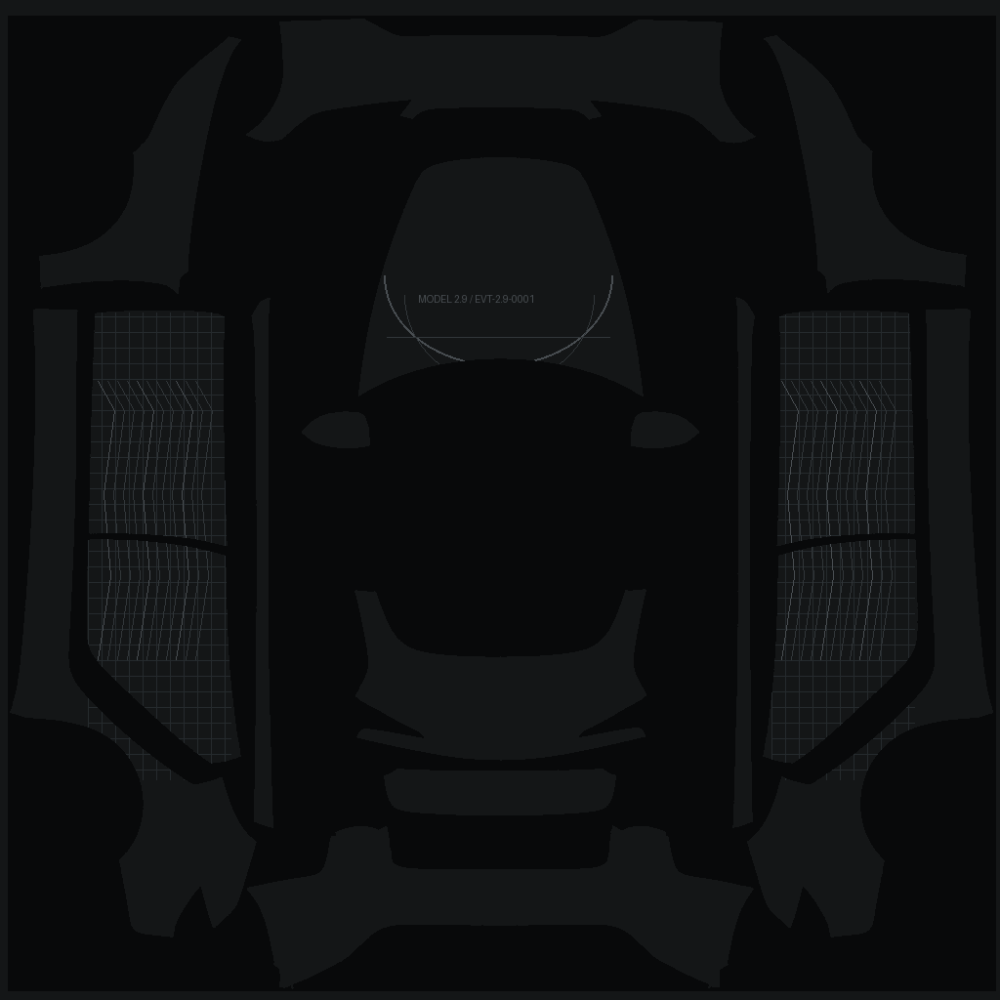
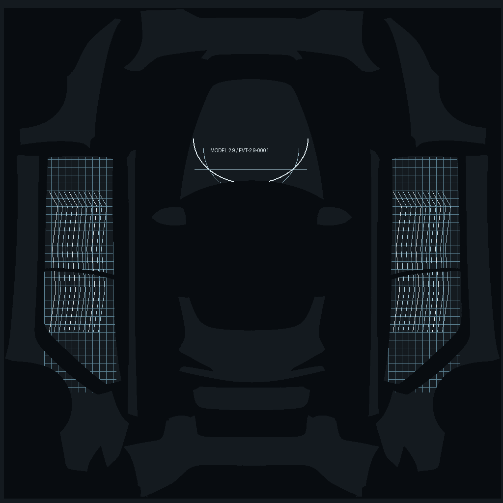

# 0001 — Ghost Reflective Texture Exploration

**Date:** 2026-10-11 · **Status:** Exploring / no owner-selected winner.

## Three directions

The **PNG** files below are reproducibly generated **1024×1024 Tesla Paint Shop UV previews**. The existing **SVG** files remain separate schematic side-view illustrations. Day/night differences are simulated, not measurements of film retroreflectance.

| Design | Daylight UV (PNG) | Night UV (PNG) | Side-view SVG |
|---|---|---|---|
| **Aero Flow** — flowing contour lines |  |  | [Day](previews/aero-flow-day.svg) · [Night](previews/aero-flow-night.svg) |
| **Parametric Fade** — dense-to-sparse micro-diamonds |  |  | [Day](previews/parametric-fade-day.svg) · [Night](previews/parametric-fade-night.svg) |
| **Engineering Blueprint** — technical linework |  |  | [Day](previews/engineering-blueprint-day.svg) · [Night](previews/engineering-blueprint-night.svg) |

**Current proposal, not a decision:** blend Aero Flow + Parametric Fade; use Blueprint typography sparingly.

## Reproduce artwork

Node.js 18+ (SVG side views; no dependencies):
```sh
node livery/iterations/0001-2026-10-11-ghost-reflective/render-preview.mjs
```

Python 3.10+ and Pillow (1024×1024 Paint Shop UV PNG study, **masked using the exact original Tesla template already in this repo**):
```sh
python -m pip install Pillow
python livery/iterations/0001-2026-10-11-ghost-reflective/render-uv.py
```
The script generates six PNGs to `renders/` locally by default. The committed `previews/*.png` are produced from the same source by [the GitHub Actions workflow](../../../.github/workflows/livery-preview-pngs.yml) (the workflow's repository-root path is `.github/workflows/livery-preview-pngs.yml`). Check 3D UV positioning in Paint Shop; simulated night brightness is not a photometric result.

## Preserved earlier conversation artifacts

The initial concept session also generated separate raster UV comparisons, 2D side studies and a ZIP package. These PNGs are **newly regenerated from the versioned Python script**, not byte-for-byte copies of the original conversation raster files. The SVG files are separate schematic side views. Earlier comparison-board and side-study PNGs remain outside this iteration's tracked assets.

## Constraints

- Reference: [Tesla 2024+ M3P template](../../../model3-2024-performance/template.png).
- Drawings are NOT full-scale physical vinyl cutting paths.
- Actual black film daytime tone/shine and night reflection vary with material and illumination.
- Align every UV section on the vehicle before approving placement.
