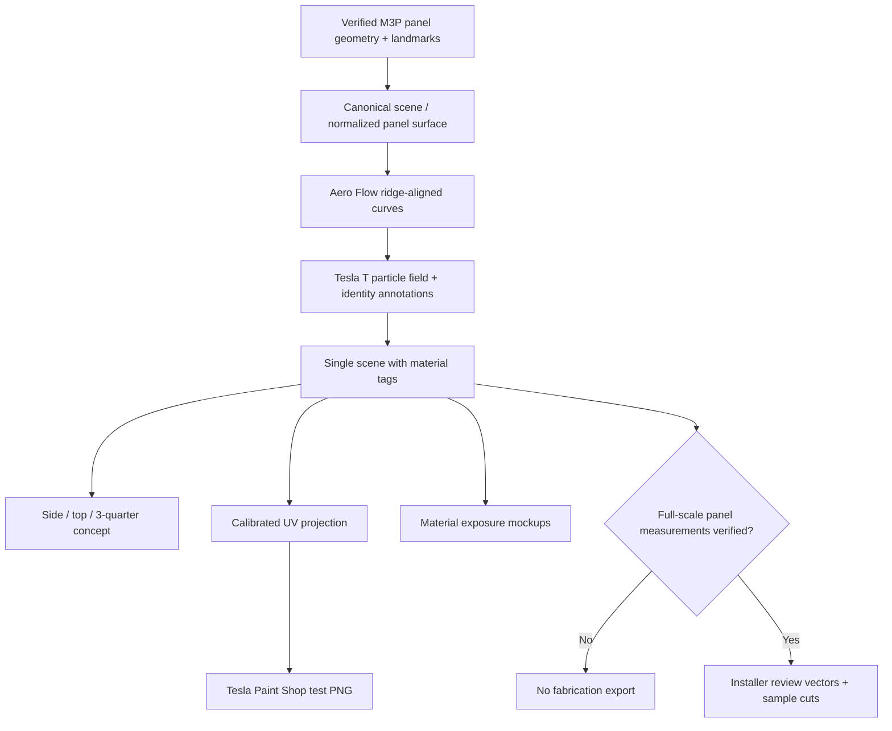

# Implementation Architecture — Iteration 0002 (design phase)

**Scope:** detailed build plan for the next implementation turn. This file **does not claim that the modules exist or a UV mapping has been calibrated yet.**

## Why V1 needs a different pipeline

V1 drew separate approximate lines on a 1024² atlas and an unrelated schematic SVG. For V2, **the master design must be independent of a renderer** and must carry explicit geometry/material/identity semantics. The original Tesla atlas remains a *display validation target*, never a cutter source.



## Proposed repository structure (future code implementation)

```text
0002-2026-10-11-ghost-aerodynamics/
├── README.md                 # Status and instructions
├── DESIGN_SPEC.md            # Creative source of truth
├── PANEL_PLAN.md             # Location / exclusion source of truth
├── ARCHITECTURE.md           # This plan
├── config.json               # Editable values; geometry intentionally uncalibrated
├── assets/
│   └── README.md             # Source and provenance notes for Tesla T vector
├── geometry/                 # CALIBRATION ONLY; initially no approved map
│   ├── landmarks.json        # Per-side/hood/tail feature points with confidence + units
│   └── uv-islands.json       # Atlas region IDs, orientation, seam adjacency, calibration
├── src/
│   ├── schema.py             # Data classes/JSON validation
│   ├── scene.py              # Single authoritative vehicle graphics scene
│   ├── geometry.py           # Body-coordinate systems, ridge splines, exclusion polygons
│   ├── flow.py               # Flow/curve families integrated with ridge anchors
│   ├── particles.py          # Seeded density field and spatial sampling of T glyphs
│   ├── glyphs.py             # Imported reviewed Tesla T vector + positioning (no shear)
│   ├── telemetry.py          # MODEL 2.9 text, annotation/tick primitives
│   ├── layers.py             # BASE / SHADOW / REVEAL / SPECIAL tags
│   ├── projection.py         # Panel-space => verified UV island transforms
│   ├── render.py             # Day/night visualization, never physical photometry claim
│   ├── export.py             # SVG, transparent layers, Paint Shop PNG outputs
│   └── validate.py           # Quality gates / collisions / seams / filenames
├── tests/
│   ├── test_determinism.py
│   ├── test_bounds_and_exclusions.py
│   ├── test_glyph_aspect_ratio.py
│   ├── test_uv_orientation.py
│   └── test_export_gates.py
└── previews/                 # Rendered only after G0/G1 milestone
```

**None of the listed future `src/`, `geometry/`, `assets/`, or `tests/` files are implied to be present by this design-plan commit.**

## Data model

All design entities have stable `id`, `panel_id`, `geometry_source`, `units`, `material_layer`, and `approval_state` fields, as appropriate.

- `Panel`: real-world panel name, visible extents, verified seam adjacency, dimension/unit confidence, safe cut bounds.
- `Landmark`: named crease/feature reference, image/mesh origin, calibrated mm or normalized provisional side-elevation coordinate, author confidence.
- `RidgeCurve`: cubic spline/Bézier control points attached to actual reference landmarks, tangent and curvature functions.
- `FlowPath`: curve traced relative to ridge(s), local line weight, phase, material tag and termination style.
- `ParticleGlyph`: reference to authorized Tesla T path, uniform scale, position, rotation, stochastic seed, material tag.
- `Telemetry`: approved short text + anchor + offset + orientation + material tag.
- `Scene`: ordered independent panels and graphic elements; exports are **views of one scene**, not independently hand-painted compositions.

**Coordinate systems (never mix):**
1. `SIDE_NORM` or `HOOD_NORM`: normalized 0..1 conceptual authoring space, explicit origin and handedness.
2. `PANEL_MM`: verified real-world coordinates for physical geometry; **not available yet**.
3. `TESLA_UV_PX`: output-only texture atlas pixels with per-island winding/orientation.
4. `SCREEN_PX`: editor/previews.

All transforms use named interfaces and store provenance. An uncalibrated `PANEL_MM` transform must raise an error for fabrication, not silently guess.

## Algorithms

### Aero Flow (ridge condition)

- Obtain **verified** `RidgeCurve` references for hood, upper-side body, lower-side body, rear haunch; do not call an image contour a physical sharp crease if it is a soft shading volume.
- Smooth tangent field `T(p)` along nearby reference curves; add low-amplitude guided influence from wheel-arch volumes and steering clearances, with globally constrained curvature so paths don't oscillate.
- Trace a small number of seed paths along this field; line width and spacing vary **continuously** with local curvature and visual priority.
- Branch/peel only at designed events near rear door/haunch. Degrade into particles according to distance along each intended flow path.
- Split each realized path at panel boundaries; never infer physical continuous strips across a gap.

Illustrative relation (conceptual, not fitted CFD): `F(p) = normalize(w1*T_ridge(p) + w2*T_haunch(p) + w3*T_artist(p))`. **Not a simulation of actual airflow**.

### Tesla T particle generator

1. Acquire a **reviewed canonical vector T** (no made-up font glyph).
2. Define a **spatial density mask** localized to rear-door → rear-quarter regions and a minor front-fender echo.
3. Candidate placement by deterministic seeded variable-radius Poisson-disc sampling, not a regular checkerboard grid.
4. Orient glyph baseline/tangent with local flow direction; preserve uniform aspect ratio; filter collisions with seams, wheel arches, text and clearance buffers.
5. Co-vary *count, size, rotation and grouping* but avoid high-frequency speckle at distance. Provide a scatter-density/occupancy report per panel and quiet-pocket map.

`density(p) = design_mask(p) * smooth_transition_along_flow(p) * edge_clearance(p) * (1 - reserved_identity_mask(p))`. This is an art-direction heuristic, **not** real turbulence.

### MODEL 2.9 annotation

- Single typography subsystem, fully named identity snippets.
- Size constraints in real mm only after actual physical sizes are known; label visibility/counterspace checked at a human viewing scale.
- Must remain readable left/right (no mirrored glyphs/words).
- No invented torque/power or actual aerodynamic measurements.

## UV projection and validation

Prefer a compatible M3P 3D mesh with **known UV coordinates** and panel topology when available and permitted. Otherwise, explicitly mark a manually calibrated approximation and verify it through Tesla Paint Shop screenshots (left/right, hood, front and rear). UV atlas region whites/black do not tell us anatomical coordinates, unit lengths or local distortions.

Mapping must explicitly test:
- seam-crossing continuity and disappearing/reappearing lines;
- correct front/rear orientation, left/right T marks and text;
- clipping vs obstruction masks (door handles, camera/sensor, lamps);
- absence of large abrupt density walls on the mapped 3D shell;
- preview PNG `1024×1024` and `< 1 MiB` per this repo's Tesla upload instructions.

## Material/lighting simulation architecture

Assign each vector element `BASE`, `SHADOW` or `REVEAL`; keep independent layer exports. Day mode uses sampled matte/gloss **appearance presets**, not merely a lighter RGB palette. Night mode is an **illustrative** directional reveal using a selectable point-source/observer angle *until measured material samples exist*. Distinguish retroreflective, fluorescent and photoluminescent effects; they are physically different and must not share one fake "glow" model.

## Four export classes

| Export | Dependency | Permitted before geometry? |
|---|---|---|
| Concept side/top SVG/PNG | normalized reference drawings | **Yes**, clearly labeled schematic |
| Material day/night preview | visually calibrated photos & mockups | Yes, **illustrative** |
| Tesla Paint Shop UV PNG | verified/island-registered UV mapping | Only after UV calibration; **preview only** |
| Installer SVG/DXF vectors | actual measured panel geometry + field sample tests | **No** until full verification |

## Test/QA checklist

- Determinism: identical config and assets yield identical vector scene and PNG.
- Geometry: every element has unique ID; no bounding violations, mask intersections or improperly crossing seams.
- Glyph: canonical shape aspect ratio preserved; logo rotations correct both sides; wordmarks are readable.
- Visual: verify side, top and 3/4, daytime and multiple point-light night directions, with a negative-space/coverage report.
- Fabrication gate: physically scaled SVG/DXF **cannot** export while `measured_panel_geometry_verified=false`.
- File integrity: outputs are versioned, not overwritten across iterations; new ideas use 0003 rather than silently regenerating V2 into a new design.
- Verify against **actual Tesla Paint Shop**; a 2D PNG alone is not a 3D test.

## Implementation sequence (engineering milestones)

**M1 / Establish sources**: real vehicle photos in consistent angle / measure key anchor points; obtain authoritative Tesla T vector; distinguish actual creases from reflections.

**M2 / Build scene**: schemas + landmark editor + outline composer + QA; produce *side-view composition only* for user review.

**M3 / T field and identity**: area-limited Poisson sampler, glyph transform and MODEL 2.9 telemetry; implement layer separation.

**M4 / UV**: confirm islands/winding; show a left/right 3D Paint Shop check; export PNG. Fix errors in normalized authoring curves (not isolated UV patches).

**M5 / Material prototype**: test actual black-on-matte contrast and reflective brightness, cutting and removal; revise export tolerances.

**M6 / Installer production**: only after `PANEL_MM` and sample-gate approval. Keep every downstream file explicitly identified as test or fabrication.
