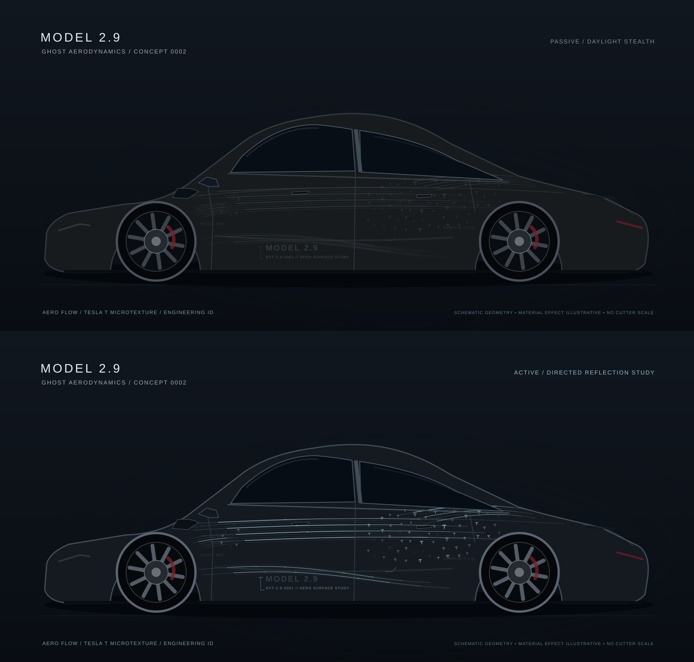
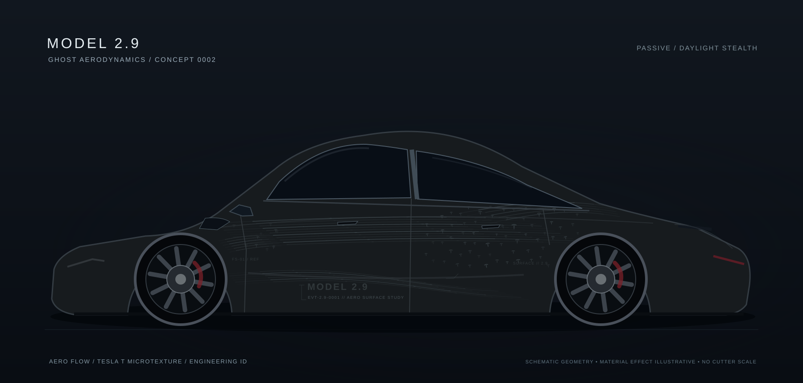
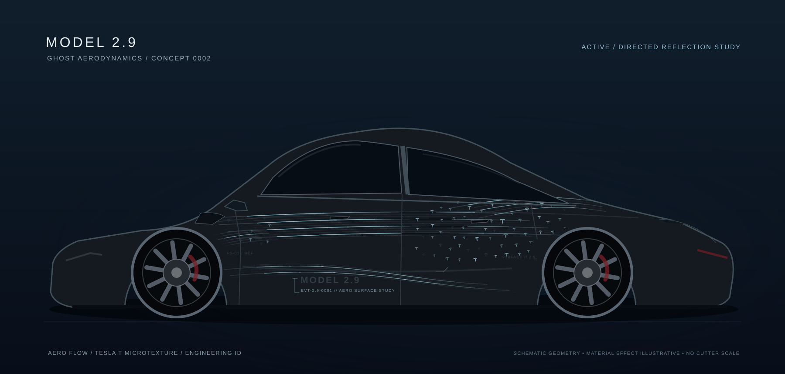

# Iteration 0002 — MODEL 2.9 / Ghost Aerodynamics

**Date:** 2026-10-11  
**Stage:** Unified design specification plus **first integrated side-view concept preview** (schematic, uncalibrated).  
**Target vehicle:** Tesla Model 3 Performance (2024+) with existing matte-black Apterix PPF.

## First V2 integrated side-view study (prototype 01)



| Daytime stealth | Directed night reveal (illustrative) |
|---|---|
|  |  |

[Annotated layer anatomy](previews/ghost-aero-anatomy.svg) · [Rear-quarter / Tesla T enlarged detail](previews/ghost-aero-detail.png)

The drawing combines **ridge-inspired Aero Flow**, **Tesla T-inspired parametric fading** and **MODEL 2.9 engineering identifiers** in one shared graphic scene (not independent concepts). The rear door/rear haunch has the principal texture density peak; front door and tail retain large negative spaces.

### Reproduction

```bash
node livery/iterations/0002-2026-10-11-ghost-aerodynamics/render-concept.mjs
```

The versioned generator writes five SVG previews to `previews/`. It is deterministic and has no npm dependencies. `concept-config.json` describes the rendering assumptions. These outputs are **first implementation/visualization evidence**, not owner-approved final art.

### Important limitations

- The vector car is an approximate **schematic side silhouette** informed by Tesla's 2024+ M3P dimensional proportions and side-profile photographic references. No model mesh, point-to-UV map, or real ridge measurements have been registered.
- The micro-glyph is a **Tesla T-inspired draft outline**, not yet verified against a canonical/approved logo asset. Do not treat it as a production logo master.
- "Night" is a stylized choice of material-color palette; real retroreflection is view/light-angle dependent and has not been tested.
- Nothing in these files is safe for a vinyl plotter; the Tesla display UV is not a physical template.
- Real geometry and UV transfer will be the next gate, after owner evaluates this 2D composition.

### Inspect at full resolution

- [PNG daytime](previews/ghost-aero-day.png)
- [PNG night](previews/ghost-aero-night.png)
- [PNG day/night board](previews/ghost-aero-comparison.png)
- [Rear quarter detail (PNG)](previews/ghost-aero-detail.png)

## Design documents

1. [DESIGN_SPEC.md](DESIGN_SPEC.md) — design language, motif, material and hierarchy.
2. [PANEL_PLAN.md](PANEL_PLAN.md) — panel-specific layout and exclusions.
3. [ARCHITECTURE.md](ARCHITECTURE.md) — eventual canonical scene/UV/manufacturing pipeline.
4. [REVIEW_GATES.md](REVIEW_GATES.md) — current evidence required before production.

Reference: [Tesla Performance UV atlas](../../../model3-2024-performance/template.png). Prior: [0001 exploration](../0001-2026-10-11-ghost-reflective/).
