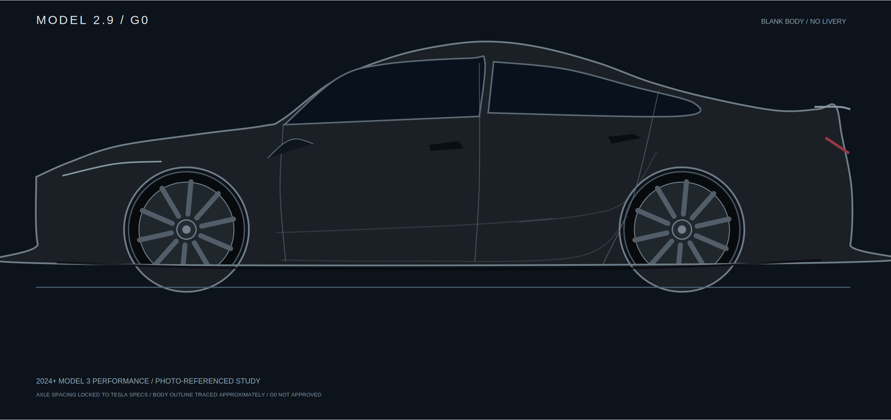

# Iteration 0003 — Track Kinetics / planning

**Date:** 2026-10-11 · **Stage: plan only; no new V3 designs generated or approved.**

Owner-directed changes:
- Retire V2's uniform long parallel pinstripes (luxury look). Create an **energetic performance/racing prototype** character through directional shear, fragmented strokes and controlled aggressive form.
- **Fix the 2024+ M3P vehicle silhouette first** using registered photo/3D geometry and OEM dimensions.
- Replace the provisional hand-drawn T with a sourced Tesla T SVG path. [Reference asset](../../assets/tesla-t-simple-icons.svg); origin/license notes [here](../../assets/README.md).
- Keep **MODEL 2.9**'s restrained engineering identity and nighttime reveal premise.

## G0 preliminary measured-axle baseline (produced, not approved)

- [**View G0 blank side PNG**](g0/previews/blank-m3p-side.png)
- [Factory-dimension overlay](g0/previews/dimension-check.png)
- [G0 source photo link, data caveats and generator](g0/README.md)
- [G0 preliminary QA assessment](g0/G0_REVIEW.md)

This is a **photo-informed contour with verified nominal chassis measurements**, not an orthographic CAD trace or an accurate as-installed car. Owner approval/registered real-car photo are required for G0 PASS. **No V3 decals have been generated.**

## Reading

- [PLAN.md](PLAN.md): staged aesthetic/technical work program and 3 candidate directions.
- [ACCEPTANCE.md](ACCEPTANCE.md): explicit pass/fail checks; what is still blocking UV and fabrication.
- [V2 review](../../reviews/V2_REVIEW_2026-10-11.md): independent assessment and accepted owner critiques.
- [V2 baseline](../0002-2026-10-11-ghost-aerodynamics/): preserved without retroactive corrections.

**No mockup, logo material study or validated side outline is asserted to exist here.**
