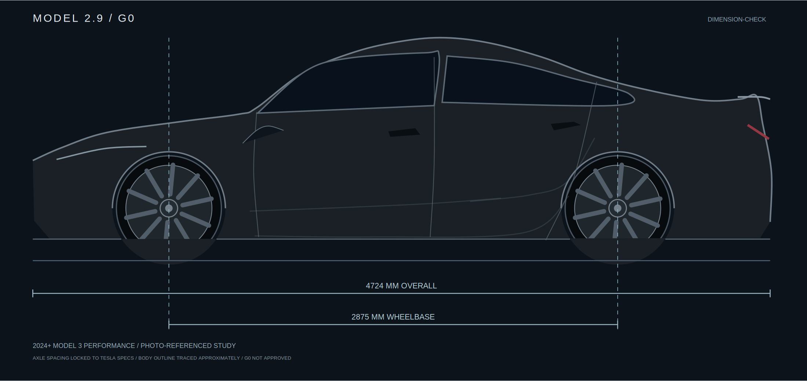

# G0 — Blank M3P geometry baseline

**2026-10-11 · Provisional photo-trace with official wheelbase/overhang anchoring; NOT a verified CAD or actual owner's car.**

| Blank body (no livery) | Measured-axle annotation |
|---|---|
|  |  |

- [Source / precise caveats / next required photo](SOURCE.md)
- [Reproducible Node generator](generate.mjs)
- [Geometry / landmark JSON](previews/geometry.json)

The visual is **not** the deleted V2 generic car; it is a preliminary tracing of a concrete 2024+ M3P side photograph. It has 4724mm length, 2875mm axle spacing and calculated OEM tire diameters. Roofline and body panels are lower confidence. Review it against the photo before approving G0.

**No racing stripes or Tesla T patterns added here.** Geometry verification is a gate.
