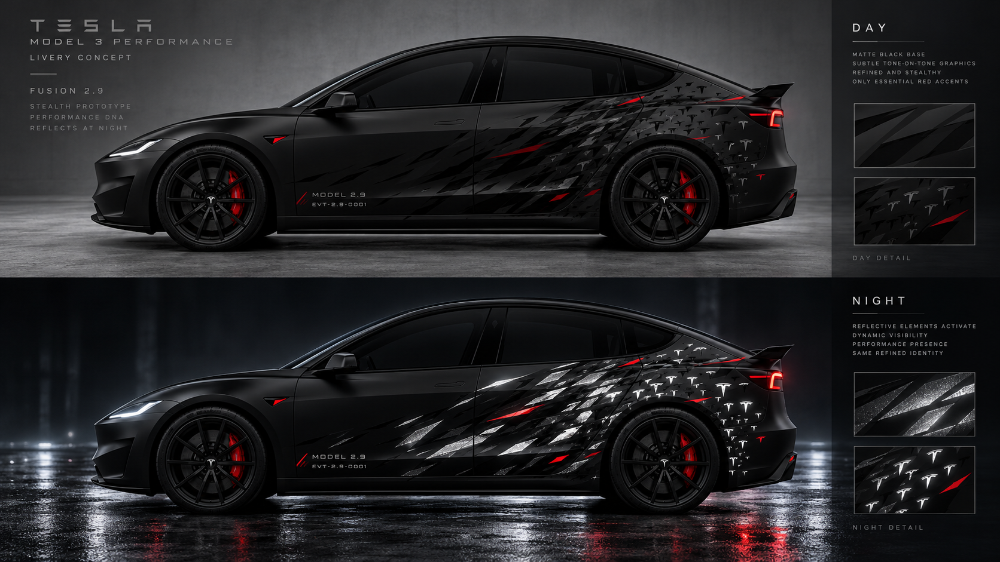
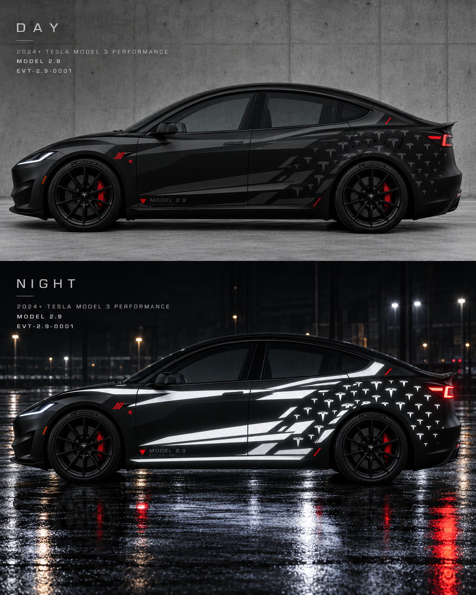
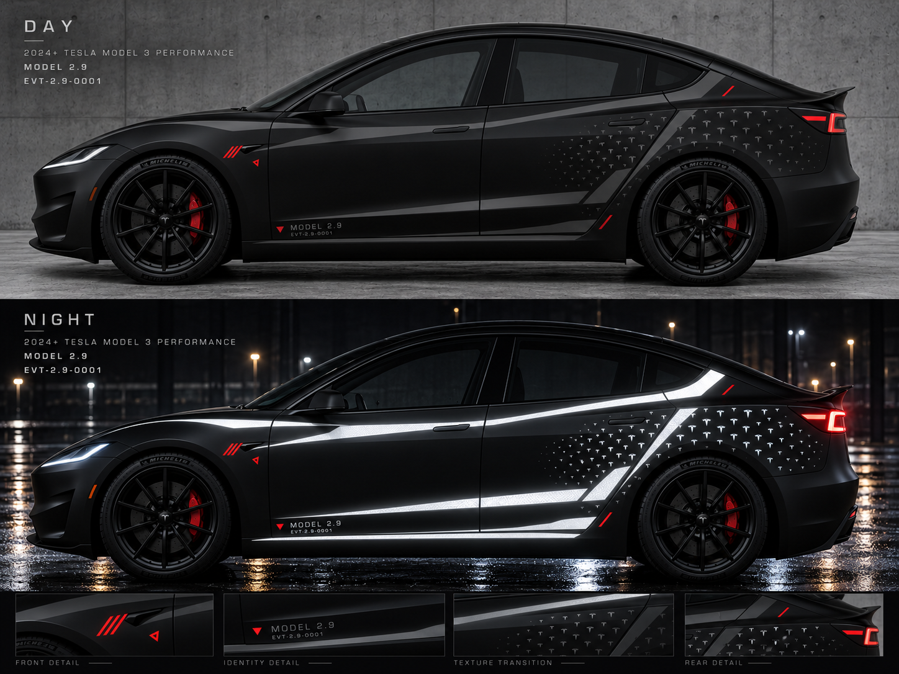

# MODEL 2.9 — AI Render Archive / 图像生成审美迭代

**存档日期：2026-10-12。19 张原始 PNG，原尺寸原字节，无重压缩或重绘。**

这里是 V3 几何校准暂停后，通过对话中的图像生成工具形成的**审美方向探索**，不同于 [V1 可复现 UV 生成器](../0001-2026-10-11-ghost-reflective/) 与 [V2 代码侧视效果图](../0002-2026-10-11-ghost-aerodynamics/)。

**重要：** AI 视觉渲染不等于 Tesla 官方准确几何、同一贴膜设计的物理光学模拟或切膜向量。图中英文标签、产品细节、T Logo 在后续生产前都需要校对；未经验证的发光仅为视觉假设。

- [逐轮审美意见与复盘（中文）](ITERATION_NOTES_zh.md)
- [原图尺寸与 Git blob SHA 清单](ORIGINAL_FILE_MANIFEST.md)
- [项目总索引](../../README.md)

## 全部原始渲染按时间顺序

01. **最初的视觉探索 A** — [查看原始 PNG](renders/01_early_exploration_A.png)（1.89 MiB）
02. **最初的视觉探索 B** — [查看原始 PNG](renders/02_early_exploration_B.png)（1.92 MiB）
03. **最初的视觉探索 C** — [查看原始 PNG](renders/03_early_exploration_C.png)（1.92 MiB）
04. **早期独立生成方案 A** — [查看原始 PNG](renders/04_early_concept_A.png)（1.81 MiB）
05. **早期独立生成方案 B** — [查看原始 PNG](renders/05_early_concept_B.png)（1.85 MiB）
06. **早期独立生成方案 C** — [查看原始 PNG](renders/06_early_concept_C.png)（1.85 MiB）
07. **A/B/C 三种视觉方向对比** — [查看原始 PNG](renders/07_three_way_direction_board.png)（2.11 MiB）
08. **白天隐身、夜间显影方向 A** — [查看原始 PNG](renders/08_stealth_day_night.png)（1.81 MiB）
09. **白天／夜间双状态方向 B** — [查看原始 PNG](renders/09_electric_day_night.png)（1.88 MiB）
10. **Fusion 2.9 双状态探索** — [查看原始 PNG](renders/10_fusion_2_9_day_night.png)（1.87 MiB）
11. **A+C 初次融合；被指出更接近 B+C，过渡偏碎** — [查看原始 PNG](renders/11_A_plus_C_fusion.png)（2.09 MiB）
12. **Constructible A+C：减少 mesh 与内部磨砂质感** — [查看原始 PNG](renders/12_constructible_A_plus_C.png)（2.05 MiB）
13. **Ridge-guided Reveal：强调按车身脊线设计** — [查看原始 PNG](renders/13_ridge_guided_reveal.png)（2.04 MiB）
14. **实色可切膜，红色工程参照点尝试** — [查看原始 PNG](renders/14_solid_cut_functional_red.png)（2.38 MiB）
15. **Sparse Ridge Texture：增加负空间、减碎片** — [查看原始 PNG](renders/15_sparse_ridge_texture.png)（2.04 MiB）
16. **Ridge Transition v2：轮拱／车顶／渐变改进尝试** — [查看原始 PNG](renders/16_ridge_transition_v2.png)（2.03 MiB）
17. **汽车设计手稿曲线方向** — [查看原始 PNG](renders/17_design_sketch_contour.png)（2.11 MiB）
18. **Sculpted Velocity：被指出过满、有鬼火感** — [查看原始 PNG](renders/18_sculpted_velocity.png)（2.04 MiB）
19. **Ghost Sculpture + NIGHT FULL REVEAL：近期审美基线** — [查看原始 PNG](renders/19_ghost_sculpture_full_reveal.png)（2.01 MiB）

## 快速视觉浏览：关键节点

| 方向 | 原图 |
|---|---|
| A/B/C 探索 |  |
| A+C 融合 |  |
| Solid-cut 实色可施工 |  |
| Sparse Ridge 纹理减法 |  |
| 汽车设计手稿语言 |  |
| 近期 Night Full Reveal 基线 |  |

**用户真实批准的，是设计原则与优化方向；上述 19 张图均为候选研究图，不等于任何一版整车施工定稿。**
