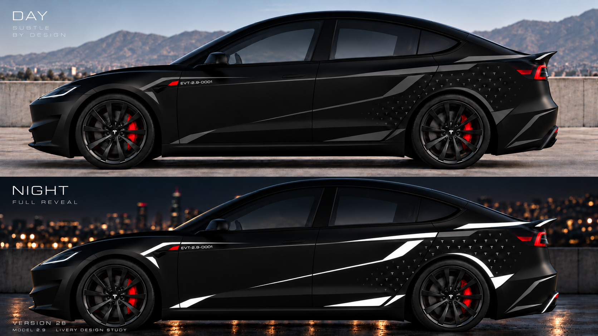

# #28 — Precision Ridge Refinement | MODEL 2.9

**日期：**2026-10-12。**阶段：**视觉探索，仅为私人 Tesla-inspired MODEL 2.9 艺术概念，**没有获得 Tesla 官方背书，也没有任何施工批准**。

本版承接 #27 的硬朗脊线语法，尝试通过**细化前翼子板的局部短楔、压制额外图形的喧宾夺主**来精修，而不是新增一套外观风格。

## 原始渲染（经 GitHub 字节级核验）

[下载/查看原始 PNG](renders/28_day_night_full_reveal_original.png)

- 原始文件：`day_to_night_ev_livery_study.png`（DAY/NIGHT 双状态拼图）
- **1672×941 RGB PNG；1,867,423 bytes**
- **SHA-256：**`eee3a8822d3749dc31d876f6c97ad6e8b6a60b5cb4631a916acc9e3f0d196fbb`
- **Git blob SHA-1：**`87de690cd9c7f48fd6adeb0e98a795142d8367fe`
- **远端 GitHub 图片路径：**`livery/iterations/0013-2026-10-12-v28-precision-ridge-refinement/renders/28_day_night_full_reveal_original.png`，以原始二进制内容写入 Git blob，SHA 与本地原图严格一致。
- ChatGPT Library 同步备份：`/MODEL-2.9/livery/28_day_night_full_reveal_original.png`。
- 画面内版本字样：`VERSION 28`，符合版本编号；此前 #26 有过错误版本标注，归档时应以本目录真实编号为准。

## 评价与下一版

- [完整中文助手评价 + #29 待讨论方案](NOTES_zh.md)。
- **助手主观评分：8.5/10**；此前 #27 8.3/10。**用户尚未单独为 #28 打分或确认这套具体贴花施工。**
- 保留：前翼子板沿真实造型趋势的短线、前门大黑色静区、后翼子板较为完整的硬朗折线和微 T 纹理。
- 仍需改进：上部反光长线视觉跨度略大；后轮拱亮弧/T/尾翼附近独立亮楔仍略拥挤；需要区分 non-reflective 深钛灰与 NIGHT 全显影反光膜。#29 只做减法和精准形体对齐，不重新添加层次。

## 工程边界

- NIGHT 全部标为反光的图形**同色等亮、纯色无光度渐变**是设计硬约束。渲染只有审美意义，不能当作真实贴膜光学模拟；未来必须通过材质样片和实际反射角测试验证。
- 本图未验证日夜 decal 逐元素像素配准、Highland 3D 面板 geometry、用户真实 aftermarket 尾翼与后唇、微型 T 可切/排废尺寸、哑光 Apterix PPF 胶黏剂兼容、法规或耐候性。
