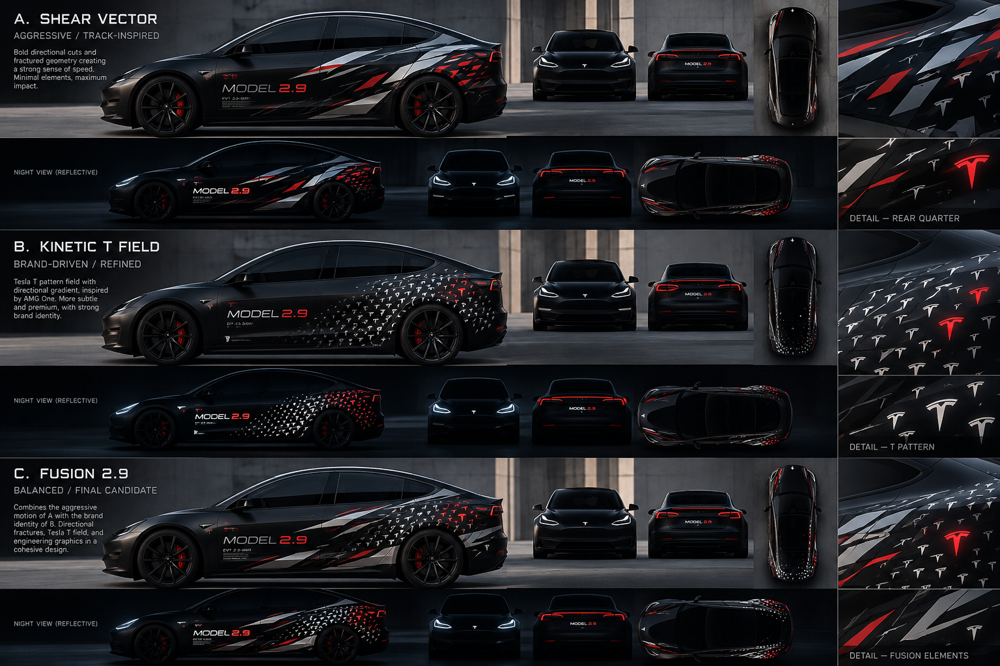
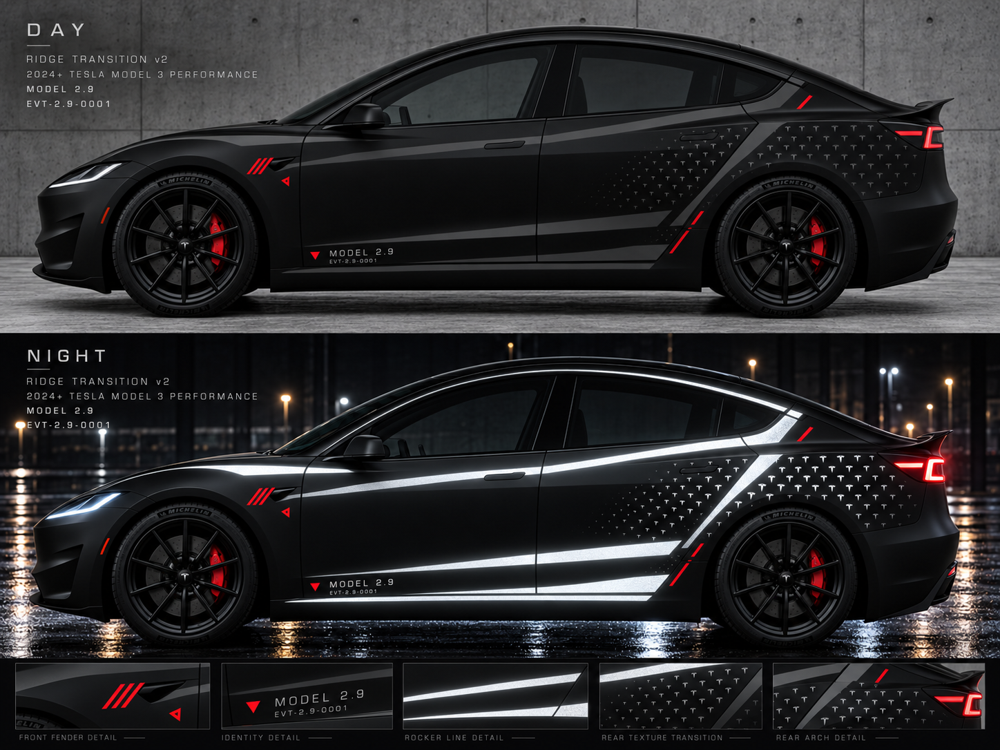
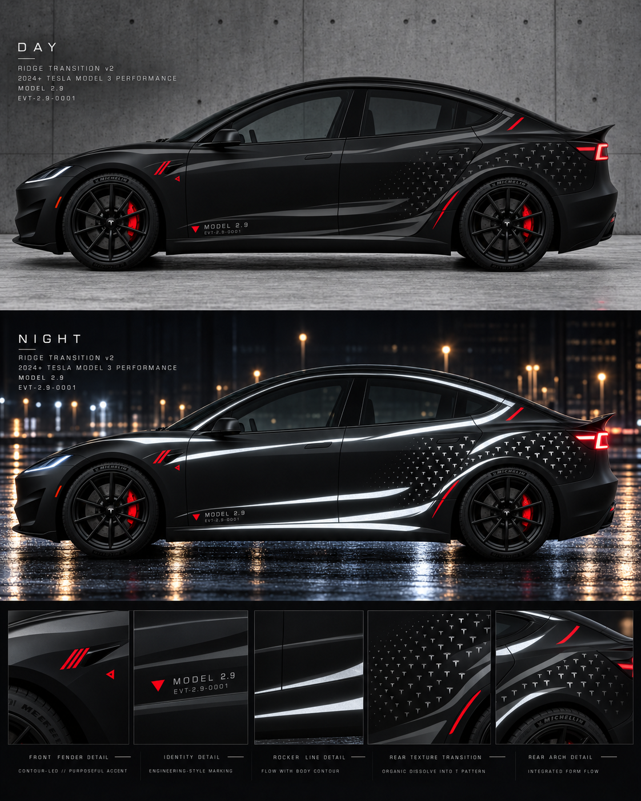
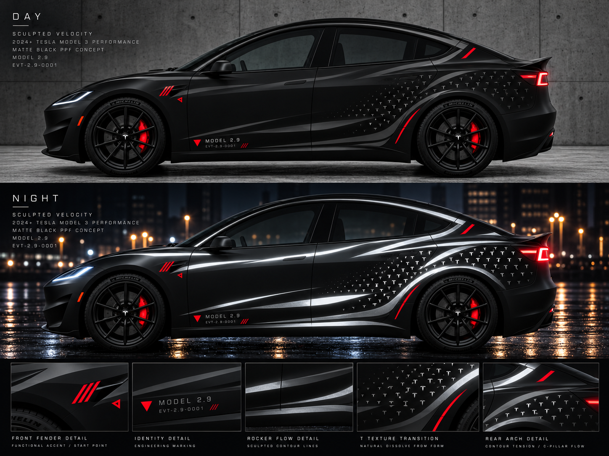

# MODEL 2.9 — 设计迭代总日志

**截至：2026-10-12。** 这是我们在聊天中讨论的设计决策与审美反馈的结构化摘要；不是聊天原文，也不是 Tesla 官方设计资料。原始 AI 概念渲染按实际发生顺序保存在 [renders/](renders/)；早期代码研究在 [early-studies/](early-studies/)；现有 GitHub 0001/0002/0003 各自的文件保持独立。

## 早期项目定位（V0–V2）

- 车辆：2024+ Tesla Model 3 Performance（Highland），现有哑光黑 Apterix PPF 底色。以**贴在现有车衣上的第二层纹理**为目标，而非重做整车改色。
- 最初想法：白天隐身/低调，夜间车灯照射后反光纹理揭示；以车身实际脊线、轮拱和肌肉量感决定纹理路径。
- 身份文案：`MODEL 2.9`、`EVT-2.9-0001`、实验原型车/工程研究语汇。
- 纹理参考：AMG 品牌微符号重复纹理、真实 Tesla T 标志、赛车与原型工程标记，而非无差别大面积装饰。
- GitHub `livery/iterations/0001...` 含三种 2D/UV 探索（Aero Flow、Parametric Fade、Blueprint），`0002...` 含首个统一代码侧视模型，`0003...` 含更运动的方向与尚未验收的 G0 车身测绘。

## AI 渲染阶段逐轮复盘（按时间顺序）

### 00 — A/B/C 基准：Shear Vector / Kinetic T / Fusion

最初强调不同策略：**A 强结构剪切**，**B 密集破碎**，**C Tesla T 品牌微纹理**。用户认可从先生成审美图、再反推代码拟合的工作流。

### 01–03 — 三张日夜双状态初选

- [01 运动剪切](renders/01-day_to_night_tesla_stealth_livery.png)：更震撼，但夜间的银白大色块易显过度装饰。
- [02 破碎气动](renders/02-day_to_night_electric_sedan_livery.png)：方向感有力却十分杂乱，纹理像数字迷彩。
- [03 T 主导](renders/03-fusion_2.9_day_to_night.png)：品牌感、暗黑低调与纹理语法优秀，但需要更强的运动结构。

**早期共识：以 A+C 作为主方向，B 的碎裂仅作为少量过渡手法。**

### 04 — Fusion A+C 结合

运动剪切与后翼子板 T 合并，白天更接近全黑，夜间剪切面与微 T 同时可见。但实色块内部的斑驳磨砂纹理、过多碎片和视觉拥挤，无法直接映射为容易维护的贴膜方案。

### 05 — Constructible A+C 初次收敛

尝试减少破碎，使主结构和 T 转向可裁切实色元素；用户指出**仿砂/网孔 texture 会迫使大量 mesh 穿孔、排废、对齐及增加脱落风险**。阶段原则：不依赖网点、镂空或大面积印刷渐变也必须成立。

### 06 — Ridge-guided Reveal

重新强调**沿真实车身特征线的反光图案**，目标是夜间勾勒车体，而不是自由漂浮的装饰线。此版仍有大片非实色的“磨砂亮条”，过多未根据具体肩线/侧裙/轮拱的变形位置，红色也只像装饰。

### 07 — 实色反光、功能性红色

用户要求抛弃大面积渐变/砂感纹理：**反光元素应是完整实心可裁切的几何形状**；并希望红色承担定位、参照或导视语义。渲染在上肩部及侧裙引入了长条、后翼子板微 T，但红色小三杠/三角仍很套路化，腰线、轮拱及 C 柱未利用彻底。

### 08 — 放大 T 的覆盖区与增加主色块

用户希望**T 区域更大、更密，且从前部色块渐变成纹理**。结果过满、碎块过大、线条性消失，T 与色块的边界仍然生硬，个体 T 过大，失去细密材质感。反思：**覆盖范围更广不等于单个符号更大，也不等于填满全部空间。**

### 09 — Sparse Ridge Texture / 留白重建

明显减少碎片恢复呼吸感，前门留白与微 T 较合理。但形成了上、下两条长条和后轮前连接的 **Z 字主框架**；仍然把纹理放在独立区域，缺乏“色块→极小单元→Tesla T”的真正共存渐变。

### 10 — Ridge Transition v2

尝试更合理的上、下脊线，后部密集 T 与工程标记。审美更整洁，但 Z 构图与拉长的 GT 装饰线条依旧明显。红色没有统一设计编码。

### 11 — Sculpted Velocity（汽车设计手稿线）

用户提出**参考汽车设计师 sketch 的“收放、曲率、曲面塑型”线条**，放弃硬直条块。曲线更自然，但夜间上肩、下腰、轮拱、C 柱同时闪亮；堆叠红色三斜杠、红三角和后轮弧线，导致用户评价为**“有点鬼火感”**。

### 12 — Ghost Sculpture / Night Full Reveal 压力测试（当前最新）

确立真正的减法：最多一条主要车身线、一条低调辅助线，T 扩散而非贴一整片品牌 Logo。三斜杠和多余红三角应剔除，红色变为**工程基准/定位/过渡节点**。用户特别纠正光照验证逻辑：**夜间仍需全车反光充分显影**，作为“所有图案同时高可见度”的最坏审美压力测试。不能靠假装部分区域不亮来掩盖设计拥挤。

## 当前最后共识（2026-10-12）

1. **DAY**：真正黑色哑光 PPF，反光图层白天仍须黑/近黑，仅靠光泽、黑度、材质差隐约可见；红色存在须有“参考/转场/终止”语义。
2. **NIGHT / FULL REVEAL**：保留同一图案，按所有反光图形都高可见度做压力测试，要求整车依然清楚、留白充分、不产生 LED 灯带或“鬼火”感。此模拟并非真实光学保证。
3. **形态**：优先遵从真实 Model 3P 的肩线、机盖力量线、侧裙下部形体、轮拱上缘和 C 柱变化，但少量重要线条即可；设计手稿式曲率张力，不是均匀 GT 平行线。
4. **纹理**：从连续的实色线/带**逐渐收窄、微观裂解、在共存区出现极小 T**，使 T 区域更大而单个 T 更小/更密；边界不应硬切。无需大面积渐变印刷或微孔 mesh。
5. **材质**：黑底/黑反光/红色工程标识为实验性材料分类，需实际打样确认 PPF 兼容性、反光颜色、裁切排废与法规。
6. **阶段**：设计方向尚未由用户认定为终稿；图像生成均为**AI 概念渲染**，不等于测量后的车身曲面、准确 Tesla 官方 logo 或实物可施工文件。

## 历史警示

- V2 的“细长平行曲线”会产生豪华 GT 感；随后过度增加剪切和裂解又会变成碎片迷彩。
- “沿脊线”不能只是在侧视图上画一条大致沿车身方向的线，必须用实车照片/3D 参考校准。
- AMG 品牌微纹理值得借鉴的是**过渡的渐变语法**，不是复刻官方纹样。
- 图片生成器会发明错误的车身细节、文字字形和高光，不应用其输出来验证具体施工厚度、颜色或真实反光亮度。
- 未进行真实材料测试之前，不能推定黑色逆反射膜一定会在夜里纯白、或者深红膜会恰好隐身。