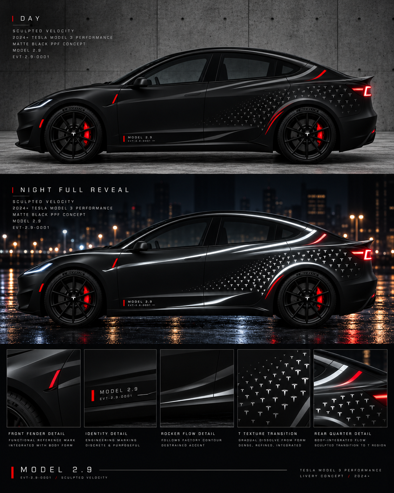

# MODEL 2.9 — 完整视觉迭代档案

**收录截至 2026-10-12 可用的渲染与工作记录。** 此目录包含原始分辨率的 13 张 AI 概念渲染、早期 2D/UV 技术研究文件、时间线与设计规范。与已存在的 [Iteration 0001](../iterations/0001-2026-10-11-ghost-reflective/)、[Iteration 0002](../iterations/0002-2026-10-11-ghost-aerodynamics/)、[Iteration 0003](../iterations/0003-2026-10-11-track-kinetics/) **互为补充而不是覆盖**。

> 注：`renders/` 都是图像生成的**审美草图**，不是 Tesla 官方车型图、真实反光光学仿真、匹配实车的生产 UV 或裁切文件。黑色反光材质在夜间变白是**Full Reveal 压力测试的审美假设**，不是材料规格保证。

## 最重要的入口

- [完整中文迭代日志](ITERATION_JOURNAL.md)：从 A/B/C → Ghost Sculpture 的 13 次概念试验、用户评论与变更原因。
- [确认过的设计约束及生产风险](DESIGN_DECISIONS.md)：日夜双状态、真实脊线、红色功能标记、T 粒子以及材料测试。
- [全部文件清单和 SHA-256](manifest.json)：便于追踪重复图与完整性。
- [早期研究与原始 ZIP](early-studies/)：三方案板、侧视研究、UV 预览、脚本和当时的归档包。

## AI 图像时间线（原始 PNG）

| # | 方案 | 查看原图 | 要点 |
|---|---|---|---|
| 00 | `wide_cinematic_design_board_concept_presentation.png` | [PNG](renders/00-wide_cinematic_design_board_concept_presentation.png) | A / B / C 三方向起始比较，白天、夜间与细节组合 |
| 01 | `day_to_night_tesla_stealth_livery.png` | [PNG](renders/01-day_to_night_tesla_stealth_livery.png) | 早期剪切 A：低调白天、较宽反光斜切夜间 |
| 02 | `day_to_night_electric_sedan_livery.png` | [PNG](renders/02-day_to_night_electric_sedan_livery.png) | 早期破碎 B：碎片纹理过密 |
| 03 | `fusion_2.9_day_to_night.png` | [PNG](renders/03-fusion_2.9_day_to_night.png) | 早期 Tesla T 主导 C：细密品牌纹理 |
| 04 | `tesla_model_3_fusion_livery_concept.png` | [PNG](renders/04-tesla_model_3_fusion_livery_concept.png) | A+C 试验：侧面剪切与后部 T 纹理融合 |
| 05 | `day_to_night_reflective_tesla_livery.png` | [PNG](renders/05-day_to_night_reflective_tesla_livery.png) | 强调施工性的剪切 + T，仍有碎片问题 |
| 06 | `day_to_night_tesla_ridge_reveal.png` | [PNG](renders/06-day_to_night_tesla_ridge_reveal.png) | 脊线引导反光概念，夜间沿车身勾勒 |
| 07 | `day_night_tesla_performance_livery.png` | [PNG](renders/07-day_night_tesla_performance_livery.png) | 改为实色反光层，探索工程用途红标 |
| 08 | `day_night_tesla_model_3_livery_board.png` | [PNG](renders/08-day_night_tesla_model_3_livery_board.png) | 扩大 T 区域与色块，但视觉过满、过于碎片化 |
| 09 | `ridge_transition_tesla_livery_concept_sheet.png` | [PNG](renders/09-ridge_transition_tesla_livery_concept_sheet.png) | Sparse Ridge Texture：留白、T 细化、过渡仍不自然 |
| 10 | `tesla_model_3_ridge_transition_concept.png` | [PNG](renders/10-tesla_model_3_ridge_transition_concept.png) | Ridge Transition：主框架 Z 感过强，红色太刻板 |
| 11 | `tesla_model_3_sculpted_velocity_board.png` | [PNG](renders/11-tesla_model_3_sculpted_velocity_board.png) | 汽车手稿式曲线 / Sculpted Velocity，曲线优雅却太满 |
| 12 | `sculpted_velocity_tesla_model_3_concept.png` | [PNG](renders/12-sculpted_velocity_tesla_model_3_concept.png) | Ghost Sculpture 精简 + Night Full Reveal 压力测试 |

## 最新一张：Ghost Sculpture / Night Full Reveal

## 早期辅助渲染（独立保留）

- [三套纹理原型对比板](early-studies/M3P_ThreeConcepts_Board.png)
- [最初的平面侧视研究](early-studies/M3P_2D_Side_Study.png)
- [Aero Flow 日间 UV](early-studies/M3P_flow_day.png) / [夜间 UV](early-studies/M3P_flow_night.png)
- [Parametric 日间 UV](early-studies/M3P_parametric_day.png) / [夜间 UV](early-studies/M3P_parametric_night.png)
- [Blueprint 日间 UV](early-studies/M3P_blueprint_day.png) / [夜间 UV](early-studies/M3P_blueprint_night.png)
- [UV 面板参考](early-studies/UV_panel_reference.png) / [官方模板识别蒙版](early-studies/official_template_mask_4px.png)
- [早期原始生成脚本](early-studies/design.py) / [原始说明](early-studies/README.txt) / [原始 ZIP](early-studies/M3P_GhostLivery_ConceptPack.zip)

**未重复提交**：自动产生的 `imagegen.png` 或 `ghostwriter_images/generated/` 别名若与上述文件二进制哈希相同，仅记录主文件一次。`M3P_AeroFlow_PaintShop.png` 与 `M3P_flow_day.png` 内容完全相同。