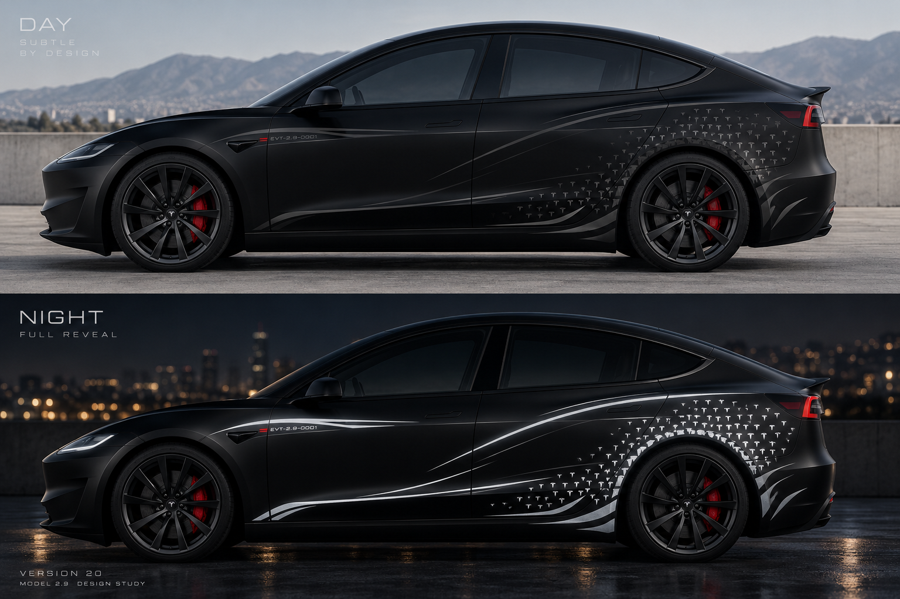
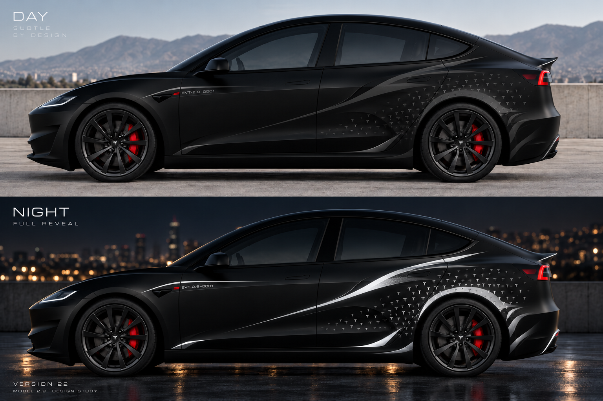

# MODEL 2.9 — 原始渲染图集 #20–#27

**GitHub 远端核验完成（2026-10-12）**：八张原始 PNG 均已上传至各自版本的 `renders/` 文件夹，文件大小与 Git Blob SHA-1 匹配原始清单。提交来源：[c68ab65](https://github.com/DMinghao/custom-wraps/commit/c68ab652e91f9b4c030663f2caa146ef86b482c4)。本图集通过 Markdown 直接嵌入远端原始 PNG，而非另外压缩。**仍属概念效果图，不是可施工裁膜文件。**

## Version 20

[打开原图](../iterations/0005-2026-10-12-v20-ghost-sculpture/renders/20_day_night_full_reveal_original.png) · 2,102,823 bytes · Git blob `b1fc716ecfaafe9dff0d6ebc0ff1f657738f92d0`

## Version 21

[打开原图](../iterations/0006-2026-10-12-v21-sculpted-tension/renders/21_day_night_full_reveal_original.png) · 2,023,377 bytes · Git blob `b005451aef08412a87309c3546cbcd95fad60e6b`

## Version 22

[打开原图](../iterations/0007-2026-10-12-v22-biomechanical-growth/renders/22_day_night_full_reveal_original.png) · 1,985,701 bytes · Git blob `91faee04518508d099c30beef293b36505b2d341`

## Version 23

[打开原图](../iterations/0008-2026-10-12-v23-overcorrection/renders/23_day_night_full_reveal_original.png) · 2,131,660 bytes · Git blob `9dfdf8952c99812cc32c0626b50f6faa8f0a73cc`

## Version 24

[打开原图](../iterations/0009-2026-10-12-v24-tesla-experimental/renders/24_day_night_full_reveal_original.png) · 1,997,742 bytes · Git blob `97c495d08e6371ba99ac8d07c2a0d8384930420a`

## Version 25

[打开原图](../iterations/0010-2026-10-12-v25-force-path/renders/25_day_night_full_reveal_original.png) · 1,947,940 bytes · Git blob `86d215e5fcd6a4fb9823743ae48b080af97bc82d`

## Version 26

[打开原图](../iterations/0011-2026-10-12-v26-ridge-led-prototype/renders/26_day_night_full_reveal_original.png) · 1,883,472 bytes · Git blob `a36cc07353d36eb71a14a09c2812ebae1ae1940a`

## Version 27

[打开原图](../iterations/0012-2026-10-12-v27-front-ridge-refinement/renders/27_day_night_full_reveal_original.png) · 1,874,723 bytes · Git blob `47ebaa470e062a33c197e03e685e36c999d55692`
